# Звіт до лабораторної роботи №2
**Виконав:** Ойцюсь Олександр Андрійович, група ІПЗ-3/1


## 1. Яка адреса сторінки в браузері? З яких частин вона складається?
Адреса сторінки: `http://127.0.0.1:5500/index.html`.
Складові частини:
- Протокол: `http://` (правила передачі даних).
- Хост (IP-адреса): `127.0.0.1` (локальний комп'ютер).
- Порт: `:5500` (порт сервера Live Server).
- Шлях до файлу: `/index.html` (назва головної сторінки).

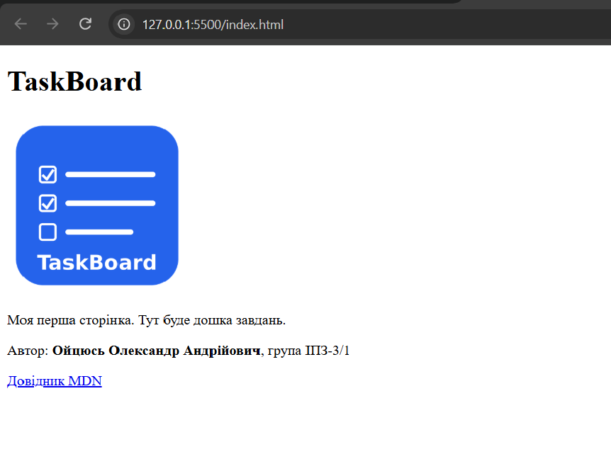


## 2. Скільки запитів зробив браузер при завантаженні сторінки і чому саме стільки?
Браузер зробив 3 запити (вкладка Network):
1. `index.html` - запит на отримання HTML-документа.
2. `logo.png` - запит на отримання зображення, вказаного в тегу ``.
3. `ws` (WebSocket) - службовий запит від Live Server для автоматичного оновлення сторінки.

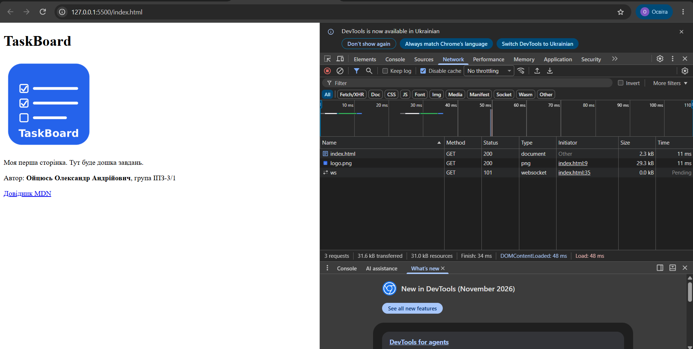


## 3. Що відбулось, коли ти поставив неправильний шлях до зображення?
При зміні шляху на `images/logo1.png` у вкладці Network з'явився запит зі статусом 404 (Not Found). На сторінці замість зображення відобразився текст з атрибута `alt` та іконка пошкодженого файлу.

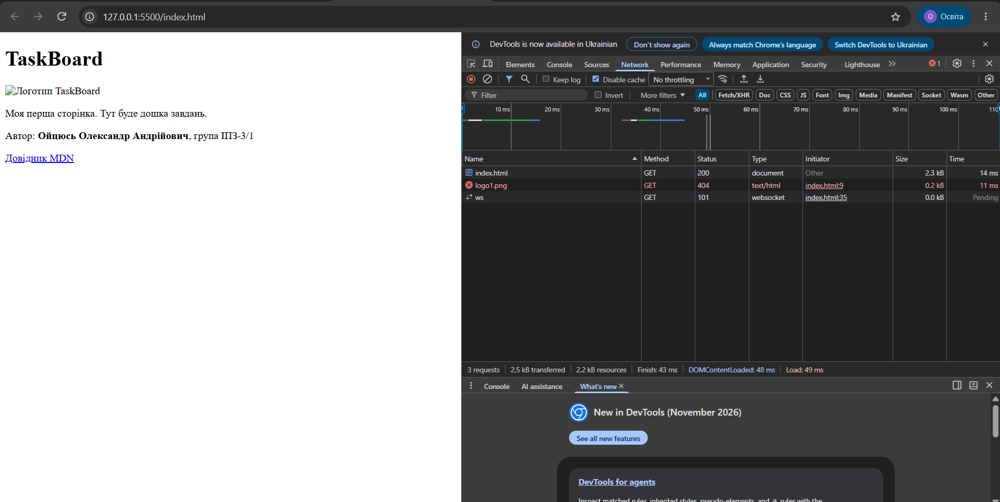


## 4. Чому зміни, зроблені через DevTools, зникли після F5?
DevTools працює з тимчасовою копією сторінки в пам'яті браузера (DOM). Зміни через панель Elements або Console (наприклад, `document.body.style.background = "lightyellow"`) не записуються у вихідний файл `index.html`. При перезавантаженні (F5) браузер повторно завантажує оригінальний файл із сервера, і тимчасові зміни скасовуються.

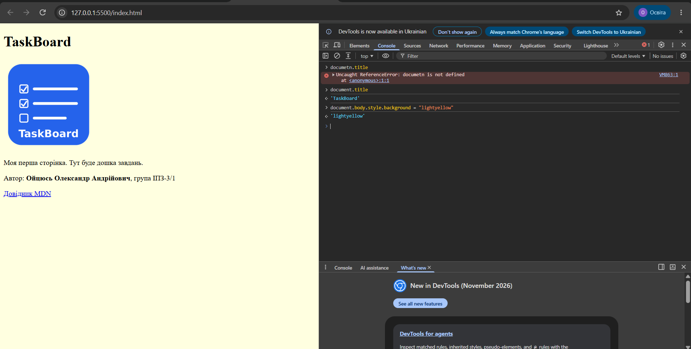


## 5. Хто в цій схемі клієнт, а хто сервер?
- Клієнт - браузер (Chrome), який відправляє запити та відображає сторінку.
- Сервер - програма Live Server, запущена на локальному комп'ютері (127.0.0.1:5500), яка приймає запити та віддає файли.

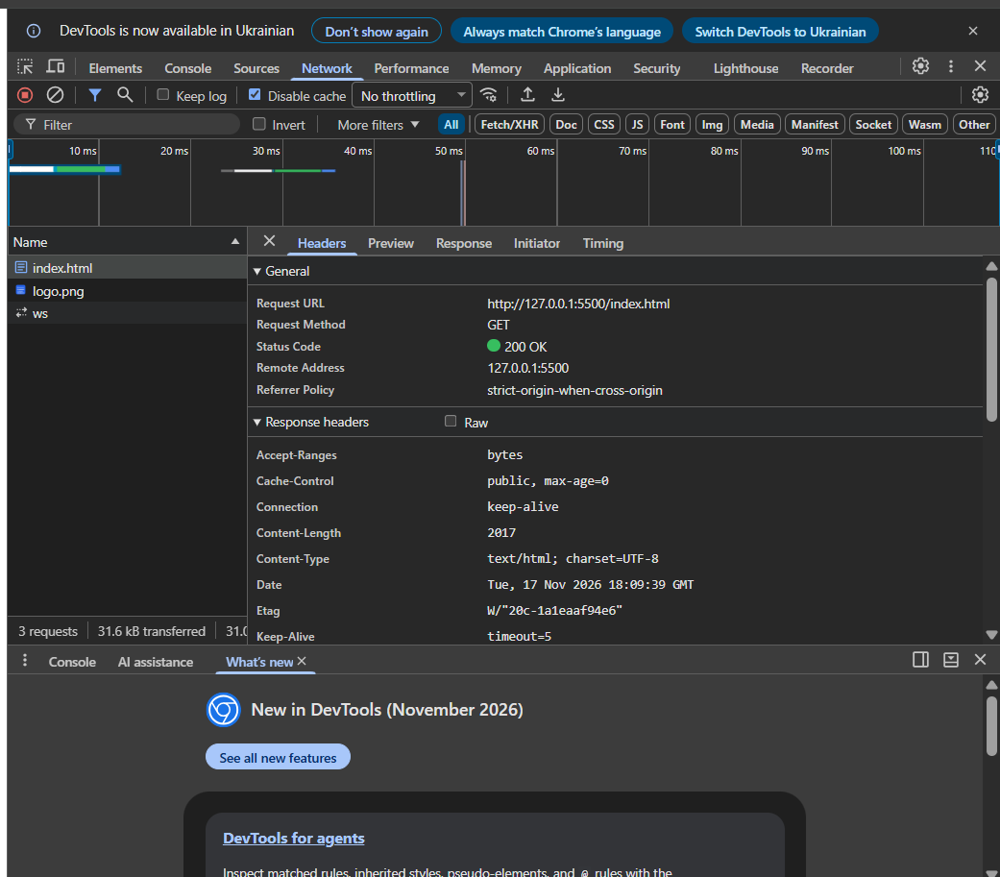


## Додатково: Крок 5.3 (Elements)
При зміні заголовка `<h1>` через вкладку Elements з "TaskBoard" на "Привіт!" зміни відобразилися на сторінці. Після натискання F5 заголовок повернувся до початкового стану, що підтверджує тимчасовість змін у DevTools і відсутність впливу на вихідний файл.

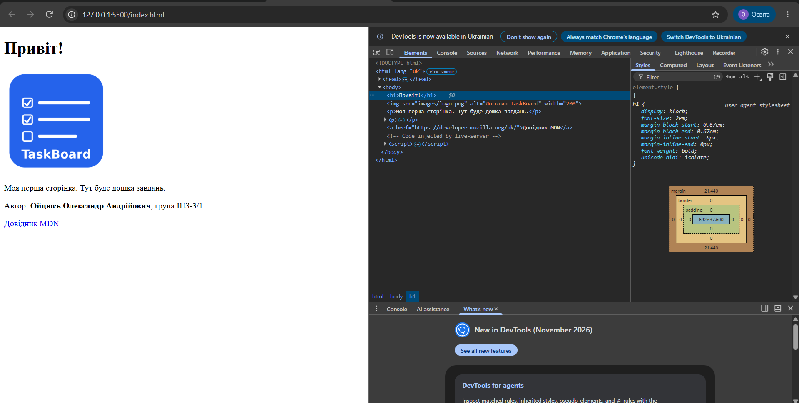


---

# Звіт до лабораторної роботи №4. Git у терміналі
**Виконав:** Ойцюсь Олександр Андрійович, група ІПЗ-3/1


## Налаштування Git
Налаштовано ім'я та пошту (`user.name`, `user.email`) і гілку за замовчуванням `main`.

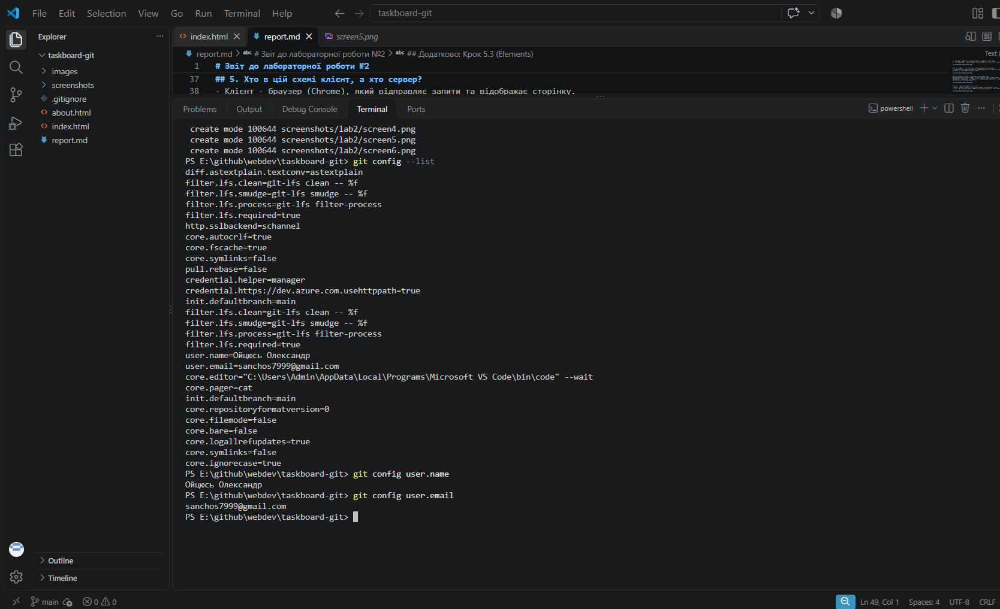


## Створення репозиторію
Після `git init` у папці `taskboard-git` Git показує `On branch main`, `No commits yet`, а всі файли позначені як Untracked.

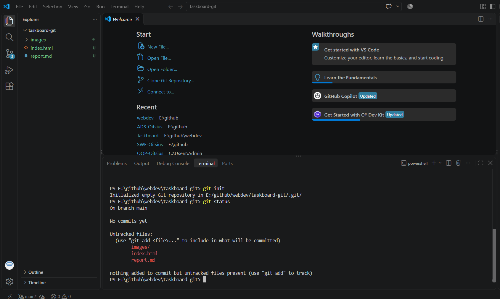


## Гілки та злиття
Я створив гілку `about-page`, додав `about.html`, закомітив і влив у `main`. Це злиття fast-forward, бо `main` за цей час не змінювався. Після злиття гілку видалено.

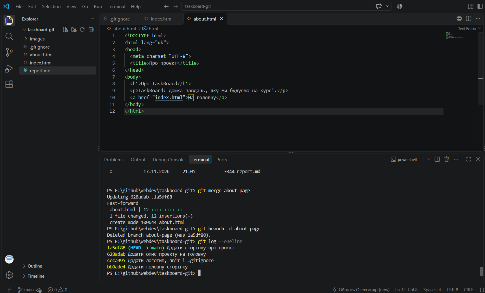


## 1. Що змінилося у виводі git status після git add?
Файл `index.html` перейшов зі списку Untracked files у зелений список Changes to be committed (індекс), а решта файлів (`images/`, `report.md`, `.gitignore`) лишилась Untracked.

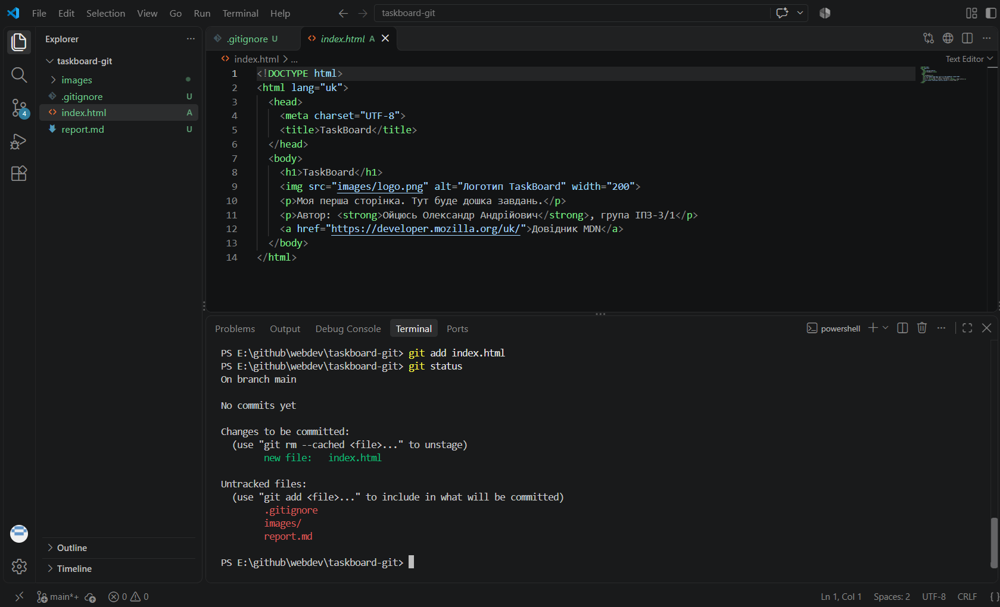


## 2. Що показує git diff?
`git diff` показує, що саме змінилось у робочій папці порівняно з останнім commit: рядки з `+` додані, рядки з `-` видалені. Так я побачив доданий абзац про TaskBoard.

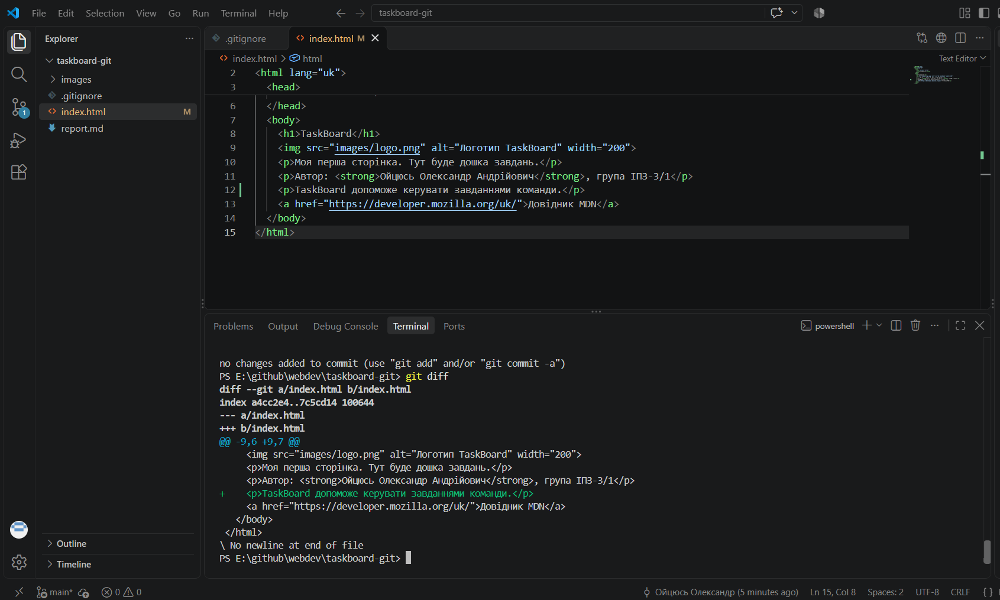


## 3. Чим відрізняється git switch main від git merge?
`git switch main` перемикає мене на гілку `main` (змінює поточну гілку), а `git merge` вливає зміни іншої гілки в поточну.


## 4. Чому виник конфлікт і як я його розв'язав?
Конфлікт виник, бо в двох гілках (`main` і `ukr-title`) я змінив один і той самий рядок `<h1>` по-різному ("TaskBoard: керуй завданнями" та "Дошка завдань"), і Git не знав, який варіант залишити. Я відкрив `index.html`, видалив службові рядки `<<<<<<<`, `=======` і `>>>>>>>`, залишив об'єднаний заголовок "Дошка завдань: керуй завданнями", потім виконав `git add index.html` і `git commit`.

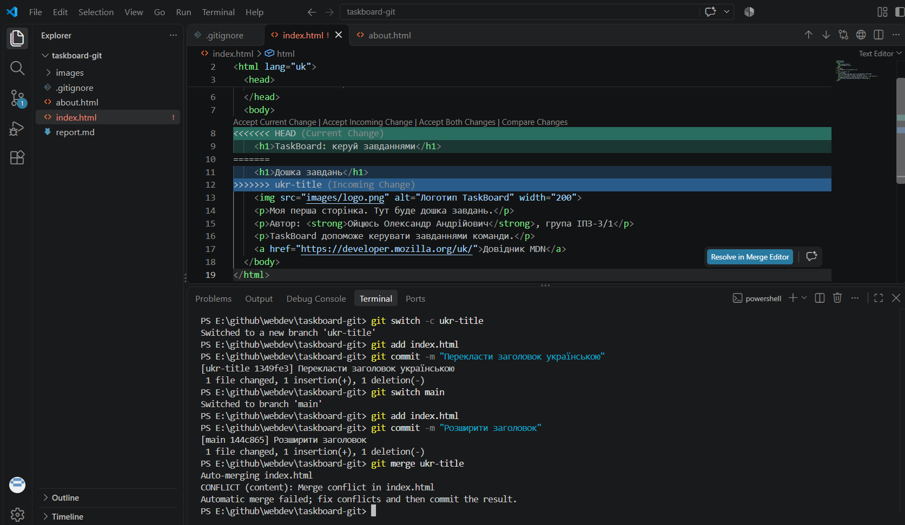

Історія після розв'язання конфлікту:

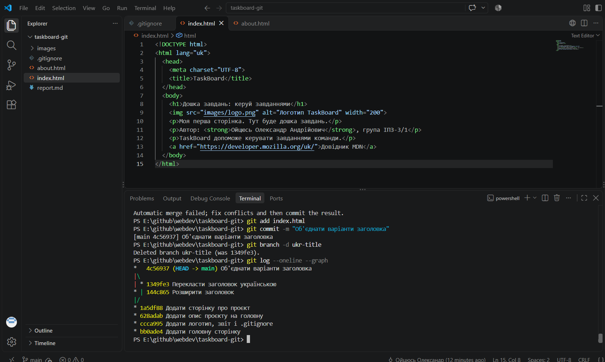


## 5. Скільки commit-ів у моїй історії?
У моїй історії 9 commit-ів (8 на момент запису цього звіту + фінальний commit зі звітом). Вивід `git log --oneline`:

```
XXXXXXX Перенести скріншоти лаби 2 у папку screenshots
4c56937 Об'єднати варіанти заголовка
144c865 Розширити заголовок
1349fe3 Перекласти заголовок українською
1a5df88 Додати сторінку про проєкт
628adab Додати опис проєкту на головну
ccca995 Додати логотип, звіт і .gitignore
bb0ade4 Додати головну сторінку
```

Фінальна історія з графом гілок:

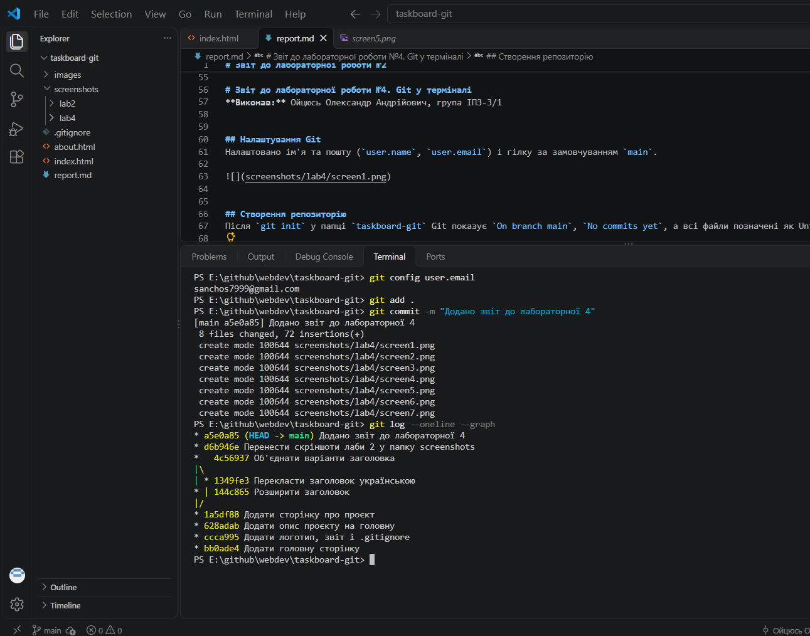